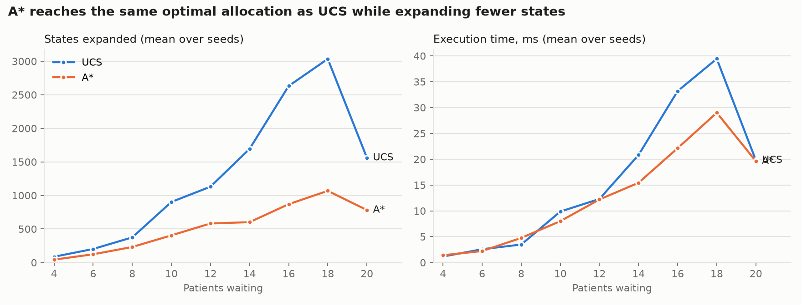

# Block 4: search and resource allocation

Block 4 decides **who gets which bed, doctor, nurse and equipment**. Block 2 has
already said what each patient needs; Search explores the possible allocations
and returns the cheapest valid one. Uniform Cost Search and A* return the same
optimal cost on every problem tested, and A* expands 38–67 % fewer states on
departments of 4 to 20 patients.

## Run

```bash
poetry run python src/block4_demo.py           # PDF example + its 3 events + ICU reallocation
poetry run python src/block4_demo.py --models  # same, predictions from the trained models
poetry run python src/search_compare.py        # UCS vs A* on 4 to 20 patients (a minute or two)
poetry run python -m unittest discover -s tests -v
```

With `--models` the ICU reallocation scenario changes: its patients have no
hourly timeline, so there is no DL prediction, and the ML model alone rates P1
High rather than Critical. P1 then needs no ICU bed, and nothing is relocated.
The scenario is written for the given predictions (the PDF's 0.87 and 0.91).

## What counts as a valid solution

The team's two rules, checked independently on every result by `check_allocation`:

1. Every **High and Critical** patient gets **everything** they need.
2. **No resource is given to two patients** at the same time.

Medium and Low patients are served when resources remain, otherwise they wait.
When the ideal resource is missing, Search first tries to **free it** by moving
a patient under treatment who no longer needs it; only when that is impossible
does it use a **fallback** (an emergency bed for an ICU need, a non-specialist
for a specialist need), and it **announces** it.

If no allocation satisfies rule 1 (for example three High/Critical patients and
two nurses), the agent says so, explains which resources are short, and still
returns the best allocation that leaves some High/Critical patients waiting,
flagged **not valid**, so Planning and the staff have something to act on.

## The problem as a state-space search

**Needs become slots.** Each waiting patient's needs, from Block 2's contract,
are cut into one slot per resource: `P1: bed(ICU), doctor(Cardiology), nurse,
equipment(PatientMonitor), …`. Patients are ordered by priority (Critical, High,
Medium, Low) and slots are filled in that order. A fixed order makes the search
a tree of choices ("which resource fills this slot?") rather than every
ordering of the same assignments.

| Element | Definition |
| --- | --- |
| State | `(pos, used, freed, moved)`: next slot to fill, resources taken, beds freed by moving someone, patients already moved |
| Initial state | `(0, ∅, ∅, ∅)` |
| Actions | `ReserveBed(P, B)`, `AssignDoctor(P, D)`, `AssignNurse(P, N)`, `AllocateEquipment(P, E)` fill the current slot; `Relocate(Q, B → B')` moves a patient under treatment out of a bed they no longer need; `LeaveWaiting(P)` skips a Medium/Low patient this round |
| Transition | the resource joins `used`; `pos` moves to the next slot (`LeaveWaiting` jumps to the next patient, `Relocate` stays on the slot it frees a bed for) |
| Goal test | every slot decided. High/Critical patients have no `LeaveWaiting` action and a used resource is never offered again, so reaching the goal means both rules hold |
| Path cost | sum of the action costs below |

Only resources that are available and not held by a patient are offered.
Interchangeable resources (two identical monitors, two general doctors) lead to
the same future, so only one of each group is offered (*symmetry breaking*,
switchable for the experiment).

## The cost function g(n)

`g(n)` is the sum of the costs of the actions taken so far. Each cost says how
much that decision hurts patients or wastes a scarce resource:

| Action | Cost | Why |
| --- | ---: | --- |
| assign any resource | 1 | using a resource is not free: fewer resources for the next patient |
| give a specialist to a patient who needs a general doctor | +2 | specialists are scarce; keep them for patients who need them |
| give an emergency bed to an exam-room patient | +2 | emergency beds are scarce |
| relocate a patient under treatment | 4 | moving a patient disrupts their care |
| non-specialist for a specialist need (fallback, announced) | +6 | the patient is treated, but not by the right specialist |
| emergency bed for an ICU need (fallback, announced) | +10 | a Critical patient without intensive care is the worst acceptable outcome |
| leave a Medium patient waiting | 8 | Medium should be seen within 60 minutes |
| leave a Low patient waiting | 5 | Low tolerates up to 120 minutes |

The **order** of the numbers is what makes the cost meaningful:

- **Serving beats waiting.** Serving a Medium patient costs about 2 (bed + doctor)
  against 8 for leaving them waiting, so free resources always go to waiting
  patients.
- **Medium before Low.** Leaving a Medium patient waiting (8) costs more than
  leaving a Low one (5), so with one bed left, Medium gets it.
- **An idle resource is used.** Even a Low patient seen by a specialist in an
  exam room (1 + 1 + 2 = 4) costs less than leaving them waiting (5).
- **Relocating beats the ICU fallback.** Moving a recovered patient (4) is cheaper
  than putting a Critical patient in an emergency bed (10), so an ICU bed is
  freed whenever possible, as the team asked. The fallback is used only when no
  ICU bed can be freed.
- **Fallbacks are a last resort,** more expensive than any normal assignment, so
  the search only picks one when nothing better exists.

When no valid allocation exists, a relaxed search also allows leaving High (40)
and Critical (100) patients waiting. Those costs are far above everything else,
so it serves as many of them as possible, Critical first.

## The heuristic h(n) for A*

A* orders the frontier by `f(n) = g(n) + h(n)`, where `h(n)` estimates the cost
still to pay. Ours is a **lower bound**: it counts only costs that the remaining
actions cannot avoid.

| Term | Lower bound | Why it is unavoidable |
| --- | --- | --- |
| each remaining slot of a High/Critical patient | 1 | it must be filled, and every assignment costs at least 1 |
| each Medium/Low patient not yet decided | min(number of slots, waiting cost) | either served (≥ 1 per slot) or left waiting |
| ICU slots beyond the free ICU beds | 4 each while movable patients remain, then 10 each | each extra ICU need is met by a relocation (4) or a fallback (+10) |
| specialist slots beyond the free specialists of that kind | 6 each | each one needs a fallback doctor (+6) |
| Medium/Low patients beyond the beds or doctors left once High/Critical needs are covered | the cheapest of their extra waiting costs | at least that many of them must wait |
| must-fill needs of one type exceed every resource of that type that could still be free | ∞ | the state is a dead end: no completion exists |

**Why A* stays optimal.** Each term counts a cost that the remaining actions must pay, and no
cost is counted twice, so `h(n)` never exceeds the true remaining cost: the
heuristic is **admissible**. A* with an admissible heuristic returns an optimal
solution; the tests confirm that h never overestimates along the optimal path
of 150 random departments, and that UCS and A* always find the same cost.

**Why it helps.** UCS expands every state cheaper than the optimum, in order of
`g`. With `h`, A* knows early that a branch is already more expensive than it
looks, for example that putting a Low patient in the last emergency bed will
force a Medium patient to wait. It also drops dead ends immediately: a problem
with no valid allocation is recognised at the start (`h = ∞`) instead of after
exploring the whole tree.

## Comparison: UCS vs A*

Departments from the HLT-010 hospital data (FAC0003, 2023-01-02, day shift),
patients from Synthea with ML/DL predictions computed by the trained models,
5 departments with a valid allocation per size. Resources are sized so each
department is feasible but contested: beds, nurses and monitors for every
High/Critical patient, one ICU bed fewer than Critical patients, Medium/Low
patients competing for the rest. Raw data: `docs/results/search_comparison.csv`.



| Patients | Slots | Optimal cost | UCS expanded | A* expanded | Saved | UCS ms | A* ms | Fallbacks | Left waiting |
| ---: | ---: | ---: | ---: | ---: | ---: | ---: | ---: | ---: | ---: |
| 4 | 14 | 20.8 | 86 | 43 | 50 % | 1.0 | 0.9 | 0.2 | 0.6 |
| 6 | 17 | 30.8 | 202 | 123 | 39 % | 2.5 | 2.3 | 0.2 | 1.2 |
| 8 | 26 | 47.2 | 375 | 232 | 38 % | 3.4 | 4.5 | 0.4 | 1.6 |
| 10 | 31 | 62.0 | 902 | 405 | 55 % | 10.3 | 8.4 | 1.6 | 2.6 |
| 12 | 39 | 74.0 | 1,130 | 582 | 49 % | 12.9 | 12.4 | 0.8 | 3.2 |
| 14 | 46 | 85.0 | 1,694 | 602 | 64 % | 19.7 | 15.5 | 1.4 | 4.6 |
| 16 | 54 | 109.8 | 2,631 | 870 | 67 % | 36.9 | 22.8 | 2.2 | 6.6 |
| 18 | 60 | 123.0 | 3,035 | 1,068 | 65 % | 42.4 | 28.6 | 2.8 | 6.8 |
| 20 | 63 | 130.6 | 1,561 | 782 | 50 % | 20.1 | 20.4 | 1.4 | 10.0 |

Means over 5 departments per size. Fallbacks and patients left waiting are the
same for both algorithms, because both return the same optimal allocation.

**Solution cost and quality.** Identical for UCS and A* in all 45 departments
(and in the 150 random ones of the tests). The allocation is optimal for both;
A* only gets there faster.

**States explored.** A* expands 38–67 % fewer states at every size. The gain is
largest when resources are contested, because the heuristic's shortage terms
then predict waits and fallbacks before the search reaches them.

**Execution time.** Each A* step costs more (it computes h for every new
state), so on small departments the two take about the same time. From 10
patients on, the states A* skips outweigh that cost and it is up to 38 % faster.
At 20 patients both get faster again: half of the patients cannot be served,
and leaving them waiting early cuts the tree.

**No valid allocation.** 13 of the departments generated (mostly large ones,
often because only 3 ventilators were in service that day) have no valid
allocation. UCS explores several hundred to a few thousand states to find out; A* knows before
expanding a single state, because h = ∞ at the start.

**Without symmetry breaking** (every identical resource offered separately),
the tree explodes: at 4 patients UCS expands 15,104 states instead of 86, and
from 8 patients both algorithms hit the 200,000-state limit on some
departments. The fixed slot order and symmetry breaking matter more than the
choice of algorithm.

### On the agent's own scenarios

| Situation | Valid | Cost | UCS expanded | A* expanded |
| --- | --- | ---: | ---: | ---: |
| PDF example, start | yes | 13 | 18 | 9 |
| ICU1 becomes unavailable | yes | 23 | 15 | 9 |
| A second Critical patient, P4, arrives | yes | 51 | 21 | 14 |
| P2 deteriorates to High | **no** | 83 | 21 | 21 |
| ICU reallocation (P5 recovered in ICU1) | yes | 12 | 12 | 9 |

- **ICU1 unavailable:** P1 gets emergency bed EB1, announced.
- **P4 arrives:** both Critical patients get announced emergency-bed fallbacks; P4
  also gets a non-specialist, because there is no neurologist.
- **P2 becomes High:** three High/Critical patients need 3 beds, doctors and nurses,
  but there are only 2 of each. The agent reports it and leaves P2 waiting,
  flagged for escalation.
- **Reallocation:** Search moves P5 to EB1 (cost 4) and gives ICU1 to P1, instead of
  the fallback (cost 10).

## Output for Planning (Block 5)

`allocate(kb.requirements())` returns a `Decision`:

```python
decision.valid          # True if both rules hold
decision.allocation     # {"patients": {"P1": {"risk": "Critical", "bed": "ICU1", "doctor": "D1",
                        #                       "nurse": "N1", "equipment": {"patient_monitor": "M1", ...}}},
                        #  "relocations": [{"patient": "P5", "from": "ICU1", "to": "EB1"}],
                        #  "waiting": ["P3"],
                        #  "announcements": ["P1 needs an ICU bed but none can be freed: ..."]}
decision.result.actions # the action sequence found, with each action's cost
decision.diagnosis      # why no valid allocation exists (empty when valid)
```

Search decides **which configuration**; Planning (Block 5) decides **in what
order** to carry it out (assign the doctor, reserve the bed, relocate P5 first,
transfer, start monitoring), respecting each action's preconditions.

## Files

| File | Role |
| --- | --- |
| `src/search/problem.py` | slots, state, actions, transitions, goal test, cost, heuristic |
| `src/search/algorithms.py` | UCS and A* (one best-first loop), `allocate`, validity check, diagnosis |
| `src/block4_demo.py` | the agent's scenarios with both algorithms side by side |
| `src/search_compare.py` | the scaling experiment, CSV and figure |
| `scenarios/icu_reallocation.json` | a recovered patient occupying the only ICU bed |
| `tests/test_search.py` | 12 tests: random departments, rules, agent scenarios |
